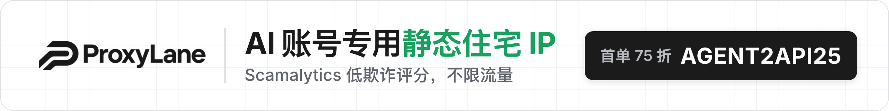
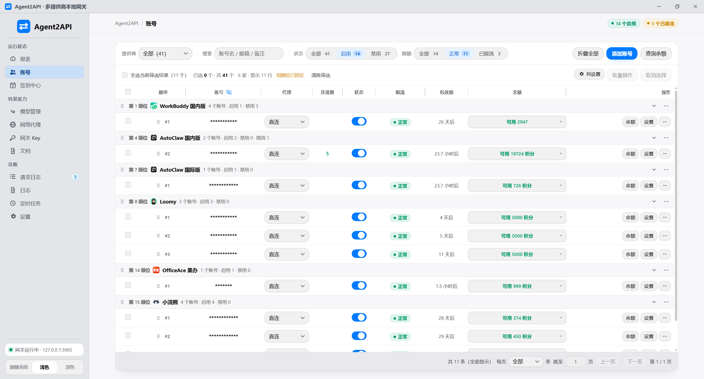
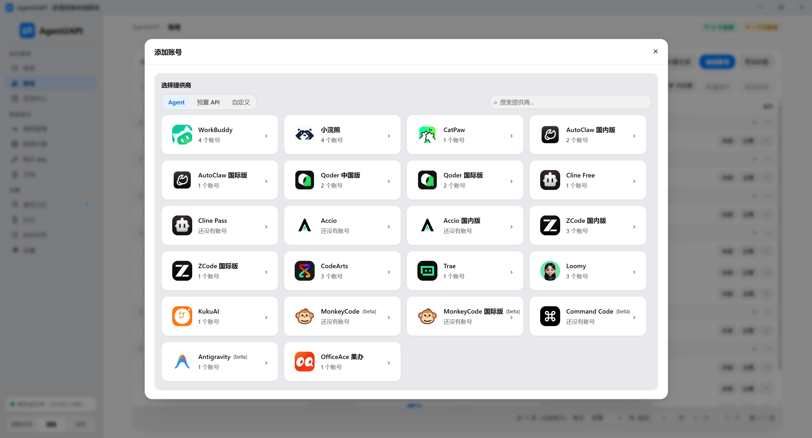
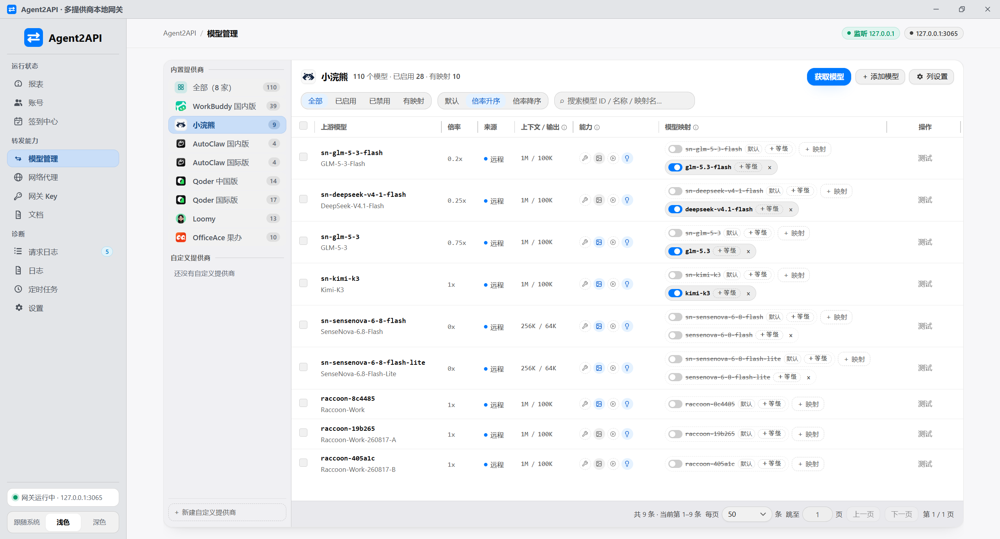
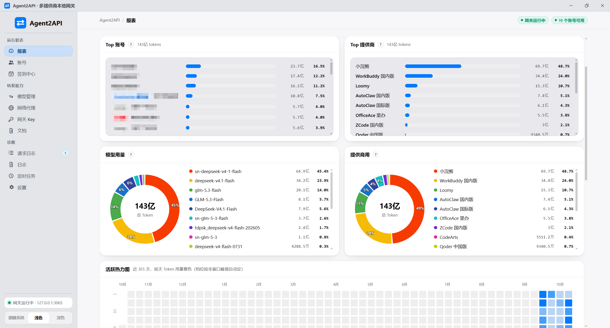
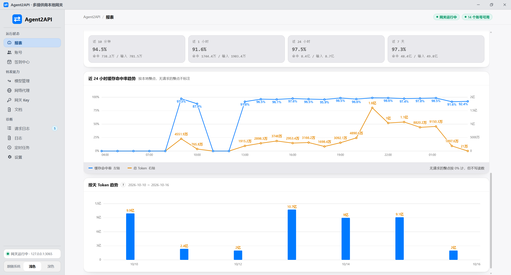

<div align="center">

# Agent2API

**An AI routing gateway with Agent client takeover, unifying model APIs and local client configuration**

**English** | [简体中文](./docs/README.zh-CN.md) | [繁體中文](./docs/README.zh-Hant.md) | [日本語](./docs/README.ja.md) | [한국어](./docs/README.ko.md) | [Português (BR)](./docs/README.pt-BR.md)

[](./LICENSE)
[](https://github.com/aimod-cc/Agent2API/releases/latest)
[](https://hub.docker.com/r/aimodcc/agent2api)
[](https://github.com/aimod-cc/Agent2API/stargazers)
[](https://github.com/aimod-cc/Agent2API/releases/latest)

[✨ Key Features](#-key-features) • [💬 Community & Support](#-community--support) • [🚀 Quick Start](#-quick-start) • [📦 Installation & deployment](./docs/install.en.md) • [📸 Screenshots](#-screenshots) • [🔧 Development & Build](#-development--build) • [📜 Usage Notice](#-usage-notice)

</div>

---

Agent2API is an **AI routing gateway with Agent client takeover**. It exposes a unified model API for custom AI providers and centralizes account routing, model mapping, gateway keys and request reports. It also manages local Agent clients' connection profiles, including importing, switching and previewing configuration changes.

## ✨ Key Features

- 🔌 **Unified model APIs** — OpenAI Chat / Responses / Images and Anthropic Messages, with a unified model catalog; Raccoon, Loomy, Antigravity, ModelScope, WorkBuddy and Doubao Work supply image generation, while Raccoon, Loomy, Antigravity, ModelScope and WorkBuddy also support reference-image editing. Both are available as AI assistant tools
- 🧭 **AI routing** — model mapping, account priority, load balancing, session affinity and failover in one place
- 🤖 **Agent client takeover** — manage multiple connection profiles for local clients, import existing settings, preview writes and switch between the gateway and custom services
- 🧩 **Plugin extensions** — additional provider implementations are installed and updated separately, not bundled with the application; custom providers do not require them
- 🛡️ **Egress proxies** — select proxy-pool exits for accounts and update tasks
- 🔑 **Gateway security** — scoped gateway keys, optional human verification for panel sign-in, and model requests refused by default until a key is configured
- 📊 **Request reports** — request volume, success rate, token usage, cache hit rate and a 365-day heatmap
- ⏰ **Background maintenance** — model catalog refresh, credential maintenance and software update checks; daily check-in runs per provider on that provider's own window (Qoder 10:01, ZCode 19:01, others follow the schedule time), plus a catch-up round that only touches accounts not yet checked in; additional provider-specific tasks are supplied by plugins
- 🖥️ **Three deployment forms** — Windows / macOS / Linux desktop apps, headless Windows / Linux servers and Docker (amd64 / arm64); no Node runtime required, with a six-language interface

## ❤️ Sponsors

<a href="https://proxylane.dev/zh-cn/isp-proxies?utm_source=agent2api&utm_medium=partnership&utm_campaign=agent2api_202610&utm_content=github_readme"></a>

<table>

<tr>
<td width="240"><a href="https://proxylane.dev/zh-cn/isp-proxies?utm_source=agent2api&utm_medium=partnership&utm_campaign=agent2api_202610&utm_content=github_readme"><picture><source media="(prefers-color-scheme: dark)" srcset="./assets/proxylane-logo-for-dark-bg.png" /></picture></a></td>
<td>Thanks to <a href="https://proxylane.dev/zh-cn/isp-proxies?utm_source=agent2api&utm_medium=partnership&utm_campaign=agent2api_202610&utm_content=github_readme">ProxyLane</a> for sponsoring this project! ProxyLane provides native static residential ISP proxies for AI accounts (Static Residential ISP): IPs come from real home broadband operators with low Scamalytics fraud scores, each IP is dedicated to you, with unlimited traffic, from $3.90. Add one exit per account on the Network proxy page. Use code <code>AGENT2API25</code> for 25% off your first purchase.</td>
</tr>

</table>

## 💬 Community & Support

- **QQ groups**: Agent2API chat groups — **group 1 (`1127656296`) and group 2 (`1130894674`) are almost full, please join group 3 (`1108276647`)**; search the number in QQ to join.
- **Telegram group**: <https://t.me/+9gM8YPvgRL02NGRl>
- **💖 Donate**: if Agent2API helps you, you are welcome to [buy the author a coffee](./docs/SPONSOR.md); donations are voluntary and unlock nothing.
- **🤝 Sponsorship / business**: want to sponsor the project, or feature your product here? Email [541675139@qq.com](mailto:541675139@qq.com).

## 🚀 Quick start

Three forms — pick the one that matches your setup; **the complete install, upgrade, uninstall and troubleshooting guide is in [Installation & deployment](./docs/install.en.md)**.

| Form | Artifact | Interface |
| --- | --- | --- |
| **Desktop** (Windows / macOS / Linux) | `Agent2API_<version>_x64-setup.exe`, `_universal.dmg`, `_amd64.deb`, `_amd64.AppImage` | App window |
| **Server** (Windows Server / Linux, headless) | `agent2api-server-windows-amd64.zip`, `agent2api-server-linux-<arch>.tar.gz` | Browser panel |
| **Docker** | `aimodcc/agent2api:latest` (amd64 / arm64) | Browser panel |

**Desktop**: add a custom provider and account, create a gateway key, then apply a connection profile on the Agent page or configure your client with `http://127.0.0.1:3065/v1` and that key. Additional provider capabilities require the corresponding plugin.

**Server** (no GUI; registered as a system service and started at boot):

```bash
# Linux
tar -xzf agent2api-server-linux-amd64.tar.gz && cd agent2api-server-linux-amd64 && sudo bash install.sh
```

```powershell
# Windows Server (administrator PowerShell)
Expand-Archive agent2api-server-windows-amd64.zip -DestinationPath C:\agent2api-pkg
cd C:\agent2api-pkg; .\install-service.ps1
```

**Docker**:

```bash
docker run -d --name agent2api --restart unless-stopped -p 3065:3065 -v ./data:/data aimodcc/agent2api:latest
```

Whichever form you pick, open the panel afterwards (`http://127.0.0.1:3065/`; use the host IP for the server and Docker forms), register the admin account, then create a key on the "Gateway Keys" page. Connectivity check: `curl http://127.0.0.1:3065/health`

**Mobile**: open `http://<gateway IP>:3065/m` in a browser (you can "Add to Home Screen" for a full-screen PWA). For a standalone icon, install `Agent2API-<version>.apk` (Android) or `Agent2API-<version>.ipa` (iOS, unsigned — re-sign it yourself) from the Release. Details: [Install & deploy → Mobile](./docs/install.en.md#mobile).

## 📸 Screenshots

### Accounts



Add account:



### Model management



### Report

Overview: requests / success rate / tokens / top model, with account and provider rankings, usage donuts and a 365-day activity heatmap:



Trends: 24-hour **cache hit rate** (line) and **token consumption** (area) on twin axes, with a per-day token bar chart below:



## 🔧 Development & Build

### Requirements

- Rust >= 1.77 and the Tauri 2 toolchain (to compile the desktop app itself; Windows also needs the WebView2 runtime)
- Node.js >= 18.17 (only to run `npm run tauri:*` and frontend build scripts; the desktop app does not depend on Node at runtime)
- Target platforms: Windows / macOS / Linux desktops, headless Windows / Linux servers, and a Docker server

### Common scripts

```bash
npm run tauri:install      # Install desktop dependencies (same as npm --prefix desktop-tauri install)
npm run tauri:dev          # Launch the desktop app in dev mode (with hot reload)
npm run tauri:build        # Build the desktop installer

npm run build:icon         # Generate the icon source image (run after changing the icon design, then run tauri icon)
```

The build artifact is `target/release/bundle/nsis/Agent2API_<version>_x64-setup.exe` (about 8.6 MB as of 3.0; `src-tauri/.cargo/config.toml` points cargo's `target-dir` at the project root's `target/`).

The macOS `.dmg` **can only be built on macOS** (`npm --prefix desktop-tauri run build -- --target universal-apple-darwin`) — it cannot be cross-compiled from Windows, so the official artifact comes from the CI `build` workflow (`macos-latest`, two targets merged). Docker images and the server archives used for in-container updates come from the same workflow's `linux-server` job, which reuses the Dockerfile's compile path so the executable inside is built from the same toolchain as the image.

## 📜 Usage Notice

### Credential and data security

Account credentials are encrypted in the local database, but exports, backups and key files may still contain sensitive data. Keep them private; do not upload them to public repositories or cloud storage, or share them with others.

### No warranty

The project is provided "as is", without guarantees of availability, stability, security or suitability for a particular purpose. Trademarks and services belong to their respective owners. The complete license and warranty terms are in [LICENSE](./LICENSE).

## 📄 License

This project uses the same [GNU Affero General Public License v3.0 (AGPL-3.0)](./LICENSE) as the provider plugin repository. Use, modification and distribution, including commercial use, are permitted under the license. Preserve copyright and license notices and fulfill applicable source-code obligations. If you offer a modified version over a network, you must offer its Corresponding Source to those users.

## ⭐ Star History

<a href="https://star-history.com/#aimod-cc/Agent2API&Date">
  <picture>
    <source media="(prefers-color-scheme: dark)" srcset="https://api.star-history.com/svg?repos=aimod-cc/Agent2API&type=Date&theme=dark" />
    <source media="(prefers-color-scheme: light)" srcset="https://api.star-history.com/svg?repos=aimod-cc/Agent2API&type=Date" />
    
  </picture>
</a>

<div align="center">

**[Download the latest release](https://github.com/aimod-cc/Agent2API/releases/latest)** • **[Report an issue](https://github.com/aimod-cc/Agent2API/issues)**

If this project helps you, a ⭐️ Star is appreciated!

</div>
