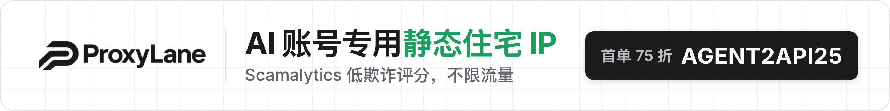
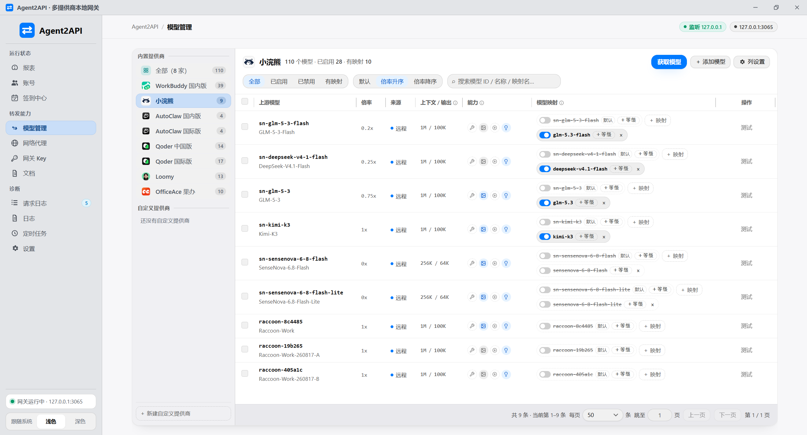
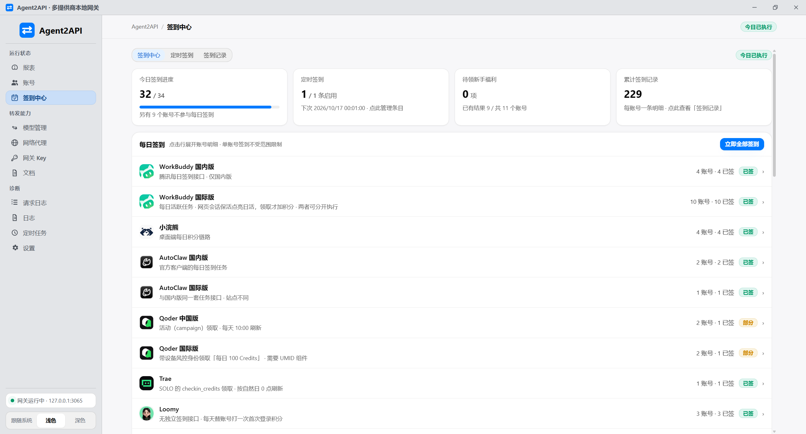

<div align="center">

# Agent2API

**Transforme o estado de login de vários clientes de desktop de IA em um gateway de API compatível com OpenAI local**

[简体中文](../README.md) | [English](./README.en.md) | [繁體中文](./README.zh-Hant.md) | [日本語](./README.ja.md) | [한국어](./README.ko.md) | **Português (BR)**

[](../LICENSE)
[](https://github.com/aimod-cc/agent2api/releases/latest)
[](https://hub.docker.com/r/aimodcc/agent2api)
[](https://github.com/aimod-cc/agent2api/stargazers)
[](https://github.com/aimod-cc/agent2api/releases/latest)

[✨ Principais recursos](#-principais-recursos) • [💬 Comunidade e suporte](#-comunidade-e-suporte) • [🤝 Provedores compatíveis](#-provedores-compatíveis) • [🚀 Início rápido](#-início-rápido) • [🐳 Implantação com Docker](#-implantação-com-docker) • [📸 Capturas de tela](#-capturas-de-tela) • [🔧 Desenvolvimento e build](#-desenvolvimento-e-build) • [📜 Aviso de uso](#-aviso-de-uso)

</div>

---

O Agent2API reúne as contas já conectadas de vários clientes de IA em um único endpoint compatível com OpenAI. Informe `http://127.0.0.1:3065/v1` em qualquer cliente que aceite um `base_url` personalizado para chamar a cota de modelos dessas contas diretamente — **sem API key do upstream e sem alterar o cliente**.

## ✨ Principais recursos

- 🔌 **Compatível com OpenAI** — aponte o `base_url` do seu cliente para o gateway: Chat, Responses e Messages são todos suportados
- 🏪 **17 provedores integrados** — WorkBuddy, Raccoon, CatPaw, Qoder, Trae e outros funcionam de imediato, além de provedores personalizados via passthrough
- 🔁 **Credenciais que se renovam sozinhas** — tokens são renovados antes de expirar, os próximos do vencimento podem ser atualizados em lote e o catálogo de modelos se mantém atual
- 🪂 **Rotação de várias contas** — contas entram na fila por prioridade, um 429 passa para a próxima e contas em cooldown são puladas sem espera
- 🛡️ **Proxies de saída** — cada conta pode ter seu próprio IP de saída; o fingerprint enviado imita o cliente oficial
- 🔑 **Segurança do gateway** — chaves de gateway com escopo, verificação humana no login e recusa por padrão enquanto nenhuma chave estiver configurada
- 📊 **Relatórios de requisições** — volume, taxa de sucesso e consumo de tokens num relance, com taxa de acerto de cache e mapa de calor de 365 dias
- ⏰ **Tarefas agendadas** — check-in automático, manutenção de credenciais e atualização do catálogo, tudo gerenciado numa página
- 💰 **Saldo e uso** — saldos e uso exibidos direto nas linhas das contas, com consulta concorrente entre elas
- 🖥️ **Duas formas de rodar** — app de desktop na bandeja (sem Node) ou imagem Docker com painel e gateway na mesma porta; interface em seis idiomas

## ❤️ Patrocinadores

<a href="https://proxylane.dev/zh-cn/isp-proxies?utm_source=agent2api&utm_medium=partnership&utm_campaign=agent2api_202610&utm_content=github_readme"></a>

<table>

<tr>
<td width="240"><a href="https://proxylane.dev/zh-cn/isp-proxies?utm_source=agent2api&utm_medium=partnership&utm_campaign=agent2api_202610&utm_content=github_readme"><picture><source media="(prefers-color-scheme: dark)" srcset="../assets/proxylane-logo-for-dark-bg.png" /></picture></a></td>
<td>A <a href="https://proxylane.dev/zh-cn/isp-proxies?utm_source=agent2api&utm_medium=partnership&utm_campaign=agent2api_202610&utm_content=github_readme">ProxyLane</a> patrocina este projeto! A ProxyLane oferece proxies de IP residencial estático nativos para contas de IA (Static Residential ISP): os IPs vêm de operadoras de banda larga residenciais reais, com pontuação de fraude baixa no Scamalytics, cada IP é dedicado a você, com tráfego ilimitado, a partir de $3.90. Adicione uma saída por conta na página "Proxy de rede". Use o código <code>AGENT2API25</code> para 25% de desconto na primeira compra.</td>
</tr>

</table>

## 💬 Comunidade e suporte

- **Grupo QQ**: grupo de chat do Agent2API, número `1127656296` (pesquise o número no QQ para entrar); dúvidas e feedback são bem-vindos.
- **💖 Doação**: se o Agent2API ajuda você, fique à vontade para [pagar um café ao autor](./SPONSOR.md); doações são voluntárias e não desbloqueiam nada.
- **🤝 Patrocínio / negócios**: quer patrocinar o projeto ou divulgar seu produto aqui? Envie um e-mail para [541675139@qq.com](mailto:541675139@qq.com).

## 🤝 Provedores compatíveis

Panorama dos recursos de proxy reverso por plataforma (✓ suportado · ✗ não suportado · — não se aplica):

| Plataforma | Requisições LLM | Renovação automática do token | Lista de modelos | Consulta de saldo | Check-in | Resgates |
| --- | :--: | :--: | :--: | :--: | :--: | :--: |
| WorkBuddy (China) | ✓ | ✓ | ✓ | ✓ | ✓ | ✓ |
| WorkBuddy (global) | ✓ | ✓ | ✓ | ✓ | ✗ | — |
| 小浣熊 | ✓ | ✓ | ✓ | ✓ | ✓ | — |
| CatPaw | ✓ | ✗ | ✓ | ✓ | ✗ | — |
| AutoClaw (China / global) | ✓ | ✓ | ✓ | ✓ | ✓ | — |
| Qoder | ✓ | ✓ | ✓ | ✓ | ✓ | — |
| Cline (Free / Pass) | ✓ | ✓ | ✓ | ✓ | — | — |
| Accio (global / China) | ✓ | ✓ | ✓ | ✓ | — | — |
| ZCode (China / global) | ✓ | ✗ | ✗ | ✓ | — | ✓ |
| CodeArts | ✓ | ✓ | ✓ | ✓ | — | ✓ |
| Trae | ✓ | ✓ | ✓ | ✓ | — | — |
| Loomy (iFlytek) | ✓ | ✗ | ✓ | ✓ | ✓ | — |
| KukuAI (Baidu Wenku) | ✓ | ✗ | ✓ | ✓ | ✓ | — |
| MonkeyCode (长亭科技, China / global) | ✓ | ✗ | ✓ | — | — | — |
| Command Code | ✓ | ✗ | ✓ | — | — | — |
| Antigravity (Google, Gemini) | ✓ | ✓ | ✓ | — | — | — |
| OfficeAce (Huawei Cloud, OfficeClaw) | ✓ | ✓ | ✓ | ✓ | ✓ | — |
| Provedores personalizados | ✓ | — | ✓ | — | — | — |

> Nota: em Lista de modelos, ✓ significa busca automática online (algumas plataformas também mantêm uma tabela estática interna como fallback); o ZCode tem apenas a tabela estática interna. ✗ em Renovação automática do token significa que a plataforma não tem um fluxo de renovação disponível (a conta continua funcionando enquanto as credenciais forem válidas). O check-in do Qoder é somente na versão da China.

`/v1/chat/completions`, `/v1/responses`, `/v1/messages` (incl. `count_tokens`) e `/v1/models` funcionam igual para todas as plataformas; mapeamento de modelos, fila global de prioridade, fallback em 429, proxy de saída, mascaramento de impressão digital de saída e relatórios de requisições valem para todas as plataformas.

> **Este projeto é apenas para aprendizado e troca de conhecimento.** Ele reutiliza o estado de login das suas contas na forma de um cliente não oficial, o que pode violar os termos dos serviços upstream; os riscos (inclusive banimento da conta) são seus. Uso comercial e contorno de cobrança são proibidos. Veja o [Aviso de uso](#-aviso-de-uso) e a [LICENSE](../LICENSE).
>
> Este é um projeto pessoal de ferramenta de proxy local, sem vínculo com qualquer fornecedor upstream ou seus produtos oficiais (a lista está no [Aviso de uso](#-aviso-de-uso)); os formatos de interface vêm da observação do tráfego dos clientes, e o upstream pode mudar a qualquer momento.

## 🚀 Início rápido

Baixe o instalador na página de [Releases](https://github.com/aimod-cc/agent2api/releases/latest) (NSIS, chinês simplificado, instala por padrão em `C:\Program Files\Agent2API` e exige aprovação de administrador durante a instalação) e basta iniciá-lo — **não é necessário instalar Node nem qualquer outro runtime**.

1. Na primeira execução, o gateway local (porta 3065) sobe dentro do processo do aplicativo e a janela principal abre. Se um diretório ou arquivo de dados de uma versão antiga for encontrado, um diálogo orienta a migração — basta seguir as instruções.
2. Clique em "Adicionar conta" na página de Contas, escolha um provedor e siga o diálogo: entre ou preencha as credenciais (login pela web / código por SMS / colar credenciais / importar o estado de login desta máquina).
3. Aponte o `base_url` do seu cliente OpenAI para `http://127.0.0.1:3065/v1` e preencha o `api_key` com qualquer coisa (por exemplo `sk-local`; o servidor não valida enquanto a autenticação estiver desativada).

Fechar a janela apenas minimiza para a bandeja, e o gateway continua encaminhando em segundo plano; para sair de verdade, clique com o botão direito no ícone da bandeja e escolha "Sair".

### Verificação

Com o gateway no ar, use curl para confirmar a conectividade (coloque em `model` qualquer nome que exista de fato em `GET /v1/models`):

```bash
curl http://127.0.0.1:3065/health
curl http://127.0.0.1:3065/v1/models

curl http://127.0.0.1:3065/v1/chat/completions \
  -H 'Content-Type: application/json' \
  -d '{"model":"deepseek-v4.1-flash","messages":[{"role":"user","content":"你好"}],"stream":true}'
```

Exemplo de integração de cliente (SDK de Python):

```python
from openai import OpenAI

client = OpenAI(base_url="http://127.0.0.1:3065/v1", api_key="sk-local")
resp = client.chat.completions.create(
    model="deepseek-v4.1-flash",     # o provedor que tiver o modelo — veja GET /v1/models
    messages=[{"role": "user", "content": "你好"}],
)
print(resp.choices[0].message.content)
```

**Páginas no navegador** (uma interface web própria, …) que chamam este endpoint com `fetch` esbarram no preflight cross-origin — o gateway **não** responde CORS por padrão, então o preflight cai na verificação de API key e recebe 401. Duas saídas: ① ative "Segurança → Acesso cross-origin do gateway" nas Configurações (origem `*`; com `*` qualquer página pode acionar o seu gateway, então configure também uma "Gateway Key"); ② coloque a página na mesma origem — sirva-a de um pequeno servidor estático local que faz proxy reverso de `/v1` para `127.0.0.1:3065`.

### Acesso pela rede local

Por padrão o gateway escuta apenas `127.0.0.1`. Ao ativar "Configurações → Geral → Acesso pela rede local" ele passa a escutar todos os adaptadores e os dispositivos da rede só precisam apontar o endereço da API para o IP desta máquina (a interface mostra o endereço completo). Por segurança, é obrigatório registrar um administrador do painel antes de ativar: a API de gerenciamento passa a exigir sessão de administrador ou uma Gateway Key e, sem chave ativa, a API de encaminhamento também recusa (o fluxo cria uma chave "padrão" automaticamente). O painel web pode ser exposto à rede local opcionalmente (fechado por padrão). As mudanças valem após reiniciar.

## 🐳 Implantação com Docker

```bash
docker run -d --name agent2api --restart unless-stopped \
  -p 3065:3065 -v ./data:/data \
  aimodcc/agent2api:latest
```

Abra `http://<host>:3065` no navegador: a primeira visita guia o **cadastro do administrador**; depois de entrar, crie uma API key na página "Gateway Keys" para os clientes — `http://<host>:3065/v1` é o endpoint compatível com OpenAI (sem nenhuma chave ele recusa o encaminhamento). Todo o estado (banco SQLite / configuração / logs) fica em um único volume `./data`.

Para quem usa compose (há imagens amd64 e arm64):

```yaml
services:
  agent2api:
    image: aimodcc/agent2api:latest
    container_name: agent2api
    restart: unless-stopped
    ports:
      - "3065:3065"
    volumes:
      - ./data:/data
```

Variáveis de ambiente (todas opcionais):

| Variável | Descrição |
| --- | --- |
| `AGENT2API_ADMIN_USER` + `AGENT2API_ADMIN_PASSWORD` | Predefine o administrador e a senha (a senha vai em texto puro e é transformada em hash na inicialização). Sem isso, use o cadastro no painel |
| `AGENT2API_PANEL_PORT` | Painel em porta separada: ao definir, o painel (interface + `/api/*`) escuta só nessa porta e basta mapear a porta principal publicamente para manter o plano de gerenciamento interno (vincule a porta do painel ao loopback, como `127.0.0.1:3066:3066`) |
| `AGENT2API_HOST` / `AGENT2API_PROXY_PORT` | Endereço de escuta (padrão `0.0.0.0`) / porta (padrão `3065`) |
| `AGENT2API_ALLOW_NO_KEY` | `1` desativa o fail-closed (serve `/v1` mesmo sem chave configurada — só para redes internas) |
| `AGENT2API_CAPTCHA_ENABLED` | Widget de verificação humana na tela de login: `1` ativado (padrão), `0` desativado |
| `AGENT2API_SELF_UPDATE` | Ponto de atualização dentro do contêiner: `1` ativado por padrão (o painel oferece "Baixar e atualizar"); `0` desativa e deixa apenas a atualização manual |
| `WORKBUDDY_UPDATE_REPO` + `WORKBUDDY_UPDATE_API_BASE` | Avançado: aponte "verificar atualizações / baixar atualizações" para a sua própria fonte. O primeiro troca o repositório (por padrão segue o upstream `aimod-cc/agent2api`; em fork, sobrescreva), o segundo troca a raiz da API (padrão `https://api.github.com`; deve devolver um JSON de release no formato do GitHub). Com uma fonte própria configurada, a lista de permissões de download passa a aceitar, além disso, apenas **o próprio host dessa fonte** (o esquema segue a fonte: uma fonte `http://` também permite download em texto puro — só para ensaios locais / espelhos internos) |

Compilar a partir do código: clone o repositório e rode `docker compose up -d --build` (a imagem contém apenas o gateway e o painel, sem toolchain Rust).

**Diferenças de recursos no painel web** (todas decorrem de "não haver cliente de desktop local"): login pela web (WorkBuddy / Qoder / Cline), código por SMS e credenciais coladas funcionam plenamente; logins pela web que exigem callback nesta máquina (AutoClaw / CatPaw / Accio / CodeArts / Trae) e a "importação do estado de login local" não estão disponíveis — use credenciais coladas.

## 📸 Capturas de tela

### Contas


Adicionar conta:


### Gerenciamento de modelos



### Relatório

Visão geral: requisições / taxa de sucesso / tokens / modelo mais usado, com rankings por conta e provedor, roscas de uso e mapa de calor de 365 dias:


Tendências: **taxa de acerto de cache** (linha) e **consumo de tokens** (área) em dois eixos, com barras de tokens por dia abaixo:


### Central de check-in



## 🔧 Desenvolvimento e build

### Requisitos

- Rust >= 1.77 e o toolchain do Tauri 2 (para compilar o app desktop; no Windows também é preciso o runtime WebView2)
- Node.js >= 18.17 (apenas para rodar `npm run tauri:*` e scripts de build do frontend; o app desktop não depende de Node em tempo de execução)

### Scripts comuns

```bash
npm run tauri:install      # Instala as dependências do desktop (equivalente a npm --prefix desktop-tauri install)
npm run tauri:dev          # Abre o app desktop em modo de desenvolvimento (com hot reload)
npm run tauri:build        # Compila o instalador do desktop

npm run build:icon         # Gera a imagem-fonte do ícone (rode após mudar o design do ícone e depois rode tauri icon)
```

O artefato de build é `target/release/bundle/nsis/Agent2API_<versão>_x64-setup.exe` (hoje com cerca de 3,0 MB; o `src-tauri/.cargo/config.toml` aponta o `target-dir` do cargo para o `target/` na raiz do projeto).

## 📜 Aviso de uso

### Apenas para aprendizado e discussão

Este projeto é um exercício prático de proxy reverso HTTP, passthrough de streaming SSE, adaptação de protocolos de múltiplos upstreams e empacotamento desktop (Tauri), e destina-se **apenas a aprendizado e pesquisa pessoal**. Não é um produto oficial e não tem qualquer vínculo, endosso ou patrocínio de Tencent e WorkBuddy / CodeBuddy, Meituan e CatPaw, SenseTime e 小浣熊, Zhipu e AutoClaw / autoglm, Alibaba e Qoder / Accio, Huawei Cloud e CodeArts / OfficeAce, ByteDance e Trae, iFlytek e Loomy, Baidu Wenku e KukuAI, 长亭科技 e MonkeyCode, Command Code, ou Google e Antigravity.

### Sobre o comportamento de proxy reverso

O que este projeto implementa é um proxy reverso local: ele reutiliza o estado de login das suas próprias contas, na sua própria máquina, e encaminha as requisições para os gateways oficiais dos upstreams. Ele não quebra nem contorna qualquer verificação de pagamento ou permissão — a cota utilizada vem sempre do que a sua própria conta já possui. Dito isso, é preciso deixar claro que essa forma de encaminhar "reutilizando o estado de login na forma de um cliente não oficial" **pode não estar de acordo com os termos de uso dos serviços upstream**; usar ou não, e toda consequência disso (incluindo, mas não se limitando a, limitação de taxa, sinalização por controle de risco, congelamento ou banimento da conta), é responsabilidade do usuário.

### Usos proibidos

É proibido usar este projeto para qualquer finalidade comercial, redistribuição com fins lucrativos, operação de contas em massa, contorno de cobrança ou limites de cota do upstream, ou qualquer atividade que viole as leis e regulamentos locais. Para chamar esses serviços de modelos em produção ou em cenários comerciais, use os canais oficiais e as APIs oficiais.

### Credenciais e risco de dados

Este projeto armazena as credenciais das contas (`accessToken` / `refreshToken` etc.) em **texto puro** no diretório de configuração local (por padrão `~/.agent2api/`), e os arquivos gerados pela exportação também contêm credenciais em texto puro. Guarde-os com cuidado: nunca faça commit em repositório público, não envie para armazenamento em nuvem nem compartilhe com terceiros. Prejuízos causados por vazamento de credenciais são de responsabilidade do usuário.

### Sem garantias e aviso de direitos

Este projeto é fornecido "como está"; o autor não faz qualquer promessa sobre disponibilidade, estabilidade, segurança ou adequação a um propósito específico. As interfaces do upstream podem mudar a qualquer momento, e o projeto pode parar de funcionar e ficar sem manutenção a qualquer momento. Os termos completos estão na [LICENSE](../LICENSE). As formas de interface, campos de protocolo e outras informações deste projeto vêm da observação e organização do tráfego de rede publicamente visível dos clientes oficiais; as marcas e serviços relacionados pertencem aos seus respectivos donos. Se um detentor de direitos considerar este projeto inadequado, entre em contato com o autor, e ele será ajustado ou removido prontamente.

## 📄 Licença

Este projeto é distribuído sob a [MIT License](../LICENSE); você pode usá-lo, modificá-lo e distribuí-lo livremente desde que mantenha o aviso de copyright.

Uma ressalva: a LICENSE traz um **Aviso de uso** após o texto da MIT, cujo item 3 **adiciona restrições** à MIT (proibição de uso comercial, proibição de redistribuição com fins lucrativos, proibição de operação de contas em massa). Portanto este projeto **não** é MIT puro — **os termos da MIT e o Aviso de uso juntos formam a licença completa**, e onde os dois chegam a conclusões diferentes sobre o mesmo ato, prevalece o mais restritivo. É também por isso que o `Cargo.toml` aponta `license-file` para a LICENSE em vez de declarar o identificador SPDX `"MIT"`.

## ⭐ Star History

<a href="https://star-history.com/#aimod-cc/agent2api&Date">
  <picture>
    <source media="(prefers-color-scheme: dark)" srcset="https://api.star-history.com/svg?repos=aimod-cc/agent2api&type=Date&theme=dark" />
    <source media="(prefers-color-scheme: light)" srcset="https://api.star-history.com/svg?repos=aimod-cc/agent2api&type=Date" />
    
  </picture>
</a>

<div align="center">

**[Baixe a versão mais recente](https://github.com/aimod-cc/agent2api/releases/latest)** • **[Reporte um problema](https://github.com/aimod-cc/agent2api/issues)**

Se este projeto for útil para você, uma ⭐️ Star é muito bem-vinda!

</div>
