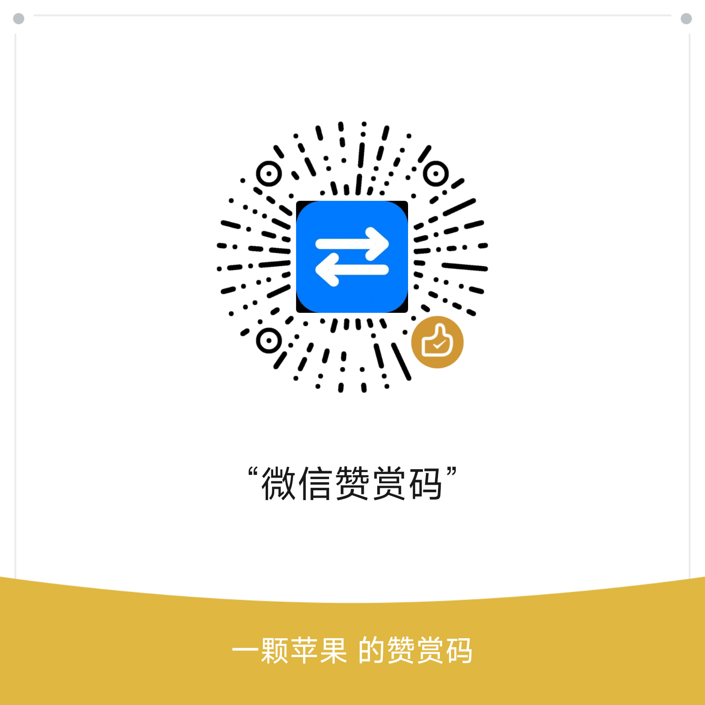

# ❤️ 支持本项目 / Support This Project

**Agent2API** 完全免费、开源：没有会员，也没有付费功能。如果它帮你省下了时间，欢迎扫码请作者喝杯咖啡。

赞赏完全自愿，不解锁任何功能，也不影响项目的任何使用。

**同样有用的支持**：给仓库点一个 Star · 在 Issues 里反馈问题与建议 · 提交 Pull Request · 把它分享给需要的朋友。

**QQ 群**：Agent2API 交流群，群号 `1127656296`（在 QQ 里搜索群号即可加入）；使用答疑与问题反馈都在这里。

**赞助 / 商务合作**：想赞助本项目，或想让你的产品出现在 README 里？发邮件到 [541675139@qq.com](mailto:541675139@qq.com)。

---

**Agent2API** is completely free and open source — no memberships, no paid features. If it saves you time, you are welcome to buy the author a coffee with the WeChat reward code above.

Donations are entirely voluntary: they unlock nothing and do not change how the project works in any way.

Other ways to help just as much: ⭐ star the repository · 🐛 file issues or suggestions · 🔧 send pull requests · 📣 share it with friends.

**QQ group**: Agent2API chat group, number `1127656296` (search it in QQ to join); questions and feedback are welcome there.

**Sponsorship / business**: want to sponsor the project, or feature your product in the README? Email [541675139@qq.com](mailto:541675139@qq.com).
